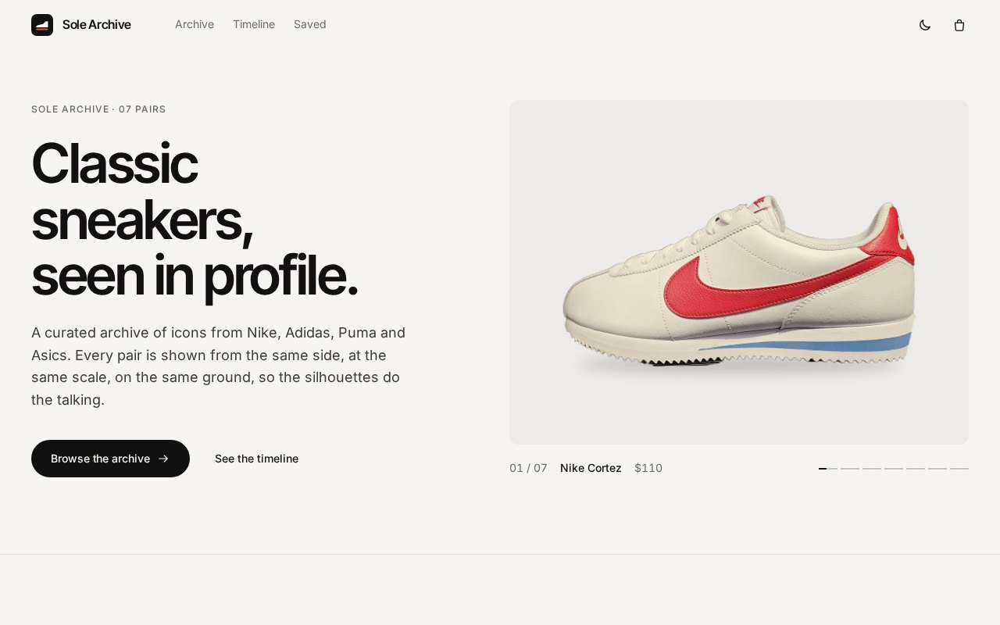
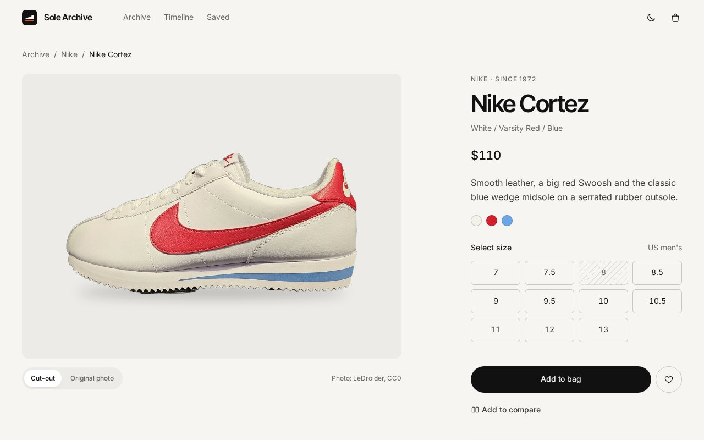

# Sole Archive

**A curated sneaker archive built with React: every pair shown in side profile, at the same scale, on the same baseline.**

[](https://rajveerrsingh.github.io/sneaker-showcase/)




## Features

- **Consistent product photography.** Seven Wikimedia Commons photos, all side profiles with the toe pointing left. Backgrounds are removed and every shoe is exported onto the same 1200×900 canvas, the same width and the same ground line, so the grid reads as one set.
- **Filter, search and sort.** Brand filter with a sliding indicator, instant search across name, brand and colourway, and four sort orders. The grid reflows with layout animations, and a row that would end with a gap gets a wide editorial card.
- **Product page.** Cut-out or original photo view, colourway swatches, a size picker that marks sold-out sizes, validation before adding to the bag, release details and the full photo credit.
- **Bag, saved pairs and compare.** A slide-out bag with quantities and subtotal, a saved list, and a side-by-side compare for any two pairs. Bag, saved list and theme persist in `localStorage`.
- **Timeline.** The pairs with well-documented release years, in order, from 1968 to 1990.
- **Light and dark themes** that follow the system setting and remember your choice, with no flash on load.
- **Accessible by default.** Semantic landmarks, a skip link, visible focus rings, labelled controls, focus trapping in the bag and compare dialogs, and every animation respects `prefers-reduced-motion`.
- **Fast and stable.** Self-hosted variable fonts, responsive `srcset` images with explicit dimensions, a preloaded hero image and zero layout shift.
- **Polished edges.** Custom logo mark and favicon, Open Graph and Twitter preview image, per-page titles, and a styled 404 page for both unknown routes and unknown products.

Prices and stock are demo data. Nothing is for sale.

<p align="center"></p>

## Tech stack

| Area | Choice |
| --- | --- |
| UI | React 19 with function components and hooks |
| State | React Context plus a small `usePersistedState` hook |
| Routing | React Router 7 with `HashRouter`, so deep links work on GitHub Pages |
| Motion | Framer Motion 11 (`layout`, `AnimatePresence`, shared `layoutId` indicators) |
| Styling | Plain CSS with design tokens in custom properties; one CSS file per component |
| Type | Inter and Inter Tight, self-hosted through Fontsource |
| Tooling | Create React App, ESLint (`react-app` config), Prettier |
| Hosting | GitHub Pages |

## Design system

All values live in [`src/styles/tokens.css`](src/styles/tokens.css):

- **Spacing:** a 4px-based scale from `--space-1` (4px) to `--space-10` (128px)
- **Type:** a fixed scale from 12px to 28px plus fluid display sizes; display headings use Inter Tight with `-0.035em` tracking
- **Radii:** three only: 6px for small controls, 12px for cards and panels, and fully round for pills
- **Colour:** warm neutrals for light and dark themes and a single orange accent, used for focus, the bag badge and active states
- **Layout:** a 12-column grid (`.grid-12`) with a fluid gutter, used by every section

## Lighthouse

Measured locally on the production build, served with gzip like GitHub Pages:

| | Performance | Accessibility | Best practices | SEO |
| --- | --- | --- | --- | --- |
| Desktop | 100 | 100 | 100 | 100 |
| Mobile | 92 | 100 | 100 | 100 |

## Architecture

```
src/
├── App.js                 routes, layout shell, page transitions
├── index.js               entry point, fonts and global styles
├── components/
│   ├── BagDrawer/         slide-out bag dialog
│   ├── Compare/           CompareBar and CompareModal
│   ├── Footer/
│   ├── Hero/              featured pair with autoplay and progress
│   ├── Icons/             inline SVG icon set
│   ├── Logo/              logo mark and wordmark
│   ├── Navbar/
│   ├── ProductCard/
│   ├── ProductGrid/       animated grid with row filling
│   ├── ProductImage/      sized image with srcset, shimmer and fallback
│   ├── Segmented/         segmented control with a sliding indicator
│   ├── Timeline/
│   └── Toast/
├── context/
│   └── StoreContext.js    bag, saved pairs, compare, theme and toasts
├── data/
│   └── sneakers.js        demo catalogue, sizes, sort options, helpers
├── hooks/
│   ├── useDialog.js       focus trap, Escape to close, scroll lock
│   └── usePersistedState.js
├── pages/
│   ├── HomePage/
│   ├── NotFoundPage/
│   ├── ProductPage/
│   └── SavedPage/
└── styles/
    ├── base.css           reset, layout, buttons and type helpers
    └── tokens.css         design tokens for both themes
public/
├── images/                cut-outs (.webp, 1200 and 640 wide) and original photos (photo/)
├── og-image.png           social preview
├── favicon.svg            plus PNG icons and the web manifest
└── 404.html               sends unknown paths to the in-app 404 page
```

Each component folder holds its JavaScript and its own stylesheet. Shared state is in one context so components stay presentational, and data helpers such as `getSneaker` and `formatPrice` live next to the catalogue.

## Getting started

Requires Node 18 or newer.

```bash
git clone https://github.com/Rajveerrsingh/sneaker-showcase.git
cd sneaker-showcase
npm install
npm start          # http://localhost:3000
```

Other scripts:

```bash
npm run build      # production build in build/
npx eslint src     # lint
```

To deploy, publish the contents of `build/` to the `gh-pages` branch.

## Credits and licences

### Photos

All product photos come from Wikimedia Commons. The cut-outs on the site are the same photos with the background removed, levelled where needed, resized and placed on a shared canvas. The original photos are available on every product page.

| Sneaker | Photographer | Licence | Source |
| --- | --- | --- | --- |
| Nike Cortez | LeDroider | CC0 | [Nike_Cortez.jpg](https://commons.wikimedia.org/wiki/File:Nike_Cortez.jpg) |
| Nike Air Max 90 | Mfagoaguna1 | CC BY-SA 4.0 | [Nike_Air_Max_90.jpg](https://commons.wikimedia.org/wiki/File:Nike_Air_Max_90.jpg) |
| Nike Dunk Low | LeDroider | CC0 | [Panda_Nike_Dunk.jpg](https://commons.wikimedia.org/wiki/File:Panda_Nike_Dunk.jpg) |
| Adidas SL 72 OG | LeDroider | CC0 | [Adidas_SL_72_OG.jpg](https://commons.wikimedia.org/wiki/File:Adidas_SL_72_OG.jpg) |
| Puma Suede Classic | LeDroider | CC0 | [Puma_Suede.jpg](https://commons.wikimedia.org/wiki/File:Puma_Suede.jpg) |
| Asics Gel-1130 | LeDroider | CC0 | [Asics_Gel-1130.jpg](https://commons.wikimedia.org/wiki/File:Asics_Gel-1130.jpg) |
| Asics Gel-NYC 2 | LeDroider | CC0 | [Asics_Gel-NYC_2.jpg](https://commons.wikimedia.org/wiki/File:Asics_Gel-NYC_2.jpg) |

The edited Air Max 90 images are shared under the same CC BY-SA 4.0 licence.

### Fonts

[Inter](https://rsms.me/inter/) and [Inter Tight](https://github.com/rsms/inter-tight) by The Inter Project Authors, under the SIL Open Font License 1.1, bundled through [Fontsource](https://fontsource.org/).

### Trademarks

Nike, Adidas, Puma and Asics names and product designs belong to their owners. This is a non-commercial portfolio project with no affiliation to any brand.

---

Designed and built by [Rajveer Singh](https://github.com/Rajveerrsingh).
